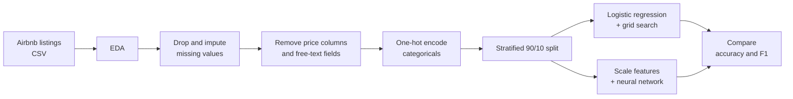

<div align="center">

# 🏙️ airbnb-price-category-predictor

**Binary classification of ~28K NYC Airbnb listings into high-priced (top quartile) or low-priced, to help hosts judge how a listing's attributes relate to its price tier.**

<p align="center">
  &nbsp;&nbsp;
  &nbsp;&nbsp;
  &nbsp;&nbsp;
  &nbsp;&nbsp;
  
</p>

</div>

---

## 📌 TL;DR

| | |
|---|---|
| **What** | A classifier that predicts whether an NYC Airbnb listing falls in the top price quartile |
| **Target** | `price_category` (high-priced vs. low-priced), derived from the nightly listing price |
| **Data** | ~28K NYC listings in `airbnbListingsData.csv.gz` |
| **Models** | Logistic regression (tuned with grid search) and a two-hidden-layer neural network |
| **Best result** | Neural network: **82.7% accuracy, 0.889 F1** (logistic regression: 74.2% accuracy, 0.851 F1). See [Results](#-results-and-key-findings). |

## 🔍 Project Overview

Hosts often struggle to tell whether a listing sits in the high or low price tier. This project trains two classifiers on listing attributes such as capacity, bedrooms, bathrooms, room type, and host details, then compares an interpretable model (logistic regression) with a more flexible one (a neural network). The goal is to describe how a listing's attributes relate to its price tier. It is not a pricing tool, and the [ethical considerations](#️-ethical-considerations) below explain why predictions should not be used as the only input to a pricing decision.

## 🎯 Objectives and Goals

1. Explore and clean ~28K NYC Airbnb listings, including missing values and class imbalance.
2. Prepare features for modeling without leaking the price into the inputs.
3. Train and tune a logistic regression baseline.
4. Train a neural network and compare it with the baseline.
5. Identify which attributes matter most and discuss the ethical risks of the model.

## 🧪 Methodology



1. **EDA:** class distribution, price boxplot, and listing counts by availability, room type, bedrooms, bathrooms, and superhost status. Correlations with the label guided feature selection.
2. **Missing values:** `host_about`, `neighborhood_overview`, `host_response_rate`, and `host_acceptance_rate` were missing for roughly 9,000+ listings and only weakly correlated with the label, so they were dropped. `bedrooms`, `beds`, and `bathrooms` were filled with the median, and `host_location` with `"Unknown"`.
3. **Leakage prevention:** `price` and the label columns were removed from the features, since the label is built from price. Free-text and unique-per-row fields (`host_name`, `amenities`, `name`, `description`) were also removed.
4. **Encoding:** remaining categorical columns were one-hot encoded (`drop_first=True`).
5. **Split:** 90% train / 10% test, stratified on the label, `random_state=1234`.
6. **Class imbalance:** low-priced listings outnumber high-priced ones, so logistic regression uses `class_weight="balanced"`.
7. **Logistic regression:** `GridSearchCV` with 5-fold cross-validation over `C` from 10⁻⁵ to 10⁴.
8. **Neural network:** standardized inputs → Dense(64, ReLU) → Dense(32, ReLU) → Dense(1, sigmoid). Trained with SGD (learning rate 0.001) for 30 epochs, with a 20% validation split.

## 📊 Results and Key Findings

| Metric (held-out test set) | Logistic Regression | Neural Network |
|---|---|---|
| Accuracy | 74.2% | **82.7%** |
| F1 score | 0.851 | **0.889** |

**Key findings**

- **Capacity and size matter most.** `accommodates`, `bedrooms`, `beds`, and `bathrooms` showed the strongest correlation with the price category, so larger properties are more likely to be high-priced.
- **No single feature is enough.** Most other numeric features were only weakly correlated with the label.
- **The neural network outperformed the baseline** by about 8.6 percentage points of accuracy, which suggests it picked up non-linear patterns that logistic regression missed.
- **The neural network started to overfit after about 15–20 epochs** (see the training curves in the notebook).
- **Trade-off:** logistic regression is easier to explain to individual hosts through its coefficients, while the neural network predicts better but is harder to interpret.

## 🗃️ Dataset

| File | Description |
|---|---|
| `data/airbnbListingsData.csv.gz` | ~28K NYC Airbnb listings used for training. TODO: source and collection date |
| `data/censusData.csv` | Census attributes by area. TODO: state whether and how this is used (see note in the repo owner's checklist) |

**Key columns** (TODO: complete the dictionary from `df.columns`)

| Column | Description |
|---|---|
| `price_category` | Target label: high-priced or low-priced |
| `price` | Nightly price (used to build the label, excluded from the features) |
| `accommodates`, `bedrooms`, `beds`, `bathrooms` | Listing size and capacity |
| `room_type` | Entire home, private room, and so on |
| `availability_365` | Days available per year |
| `host_is_superhost` | Whether the host is a superhost |
| TODO | TODO |

pandas reads the compressed file directly:

```python
import pandas as pd
df = pd.read_csv("data/airbnbListingsData.csv.gz")
```

## 🚀 Installation and Setup

### 1. Set up the project locally

**You need:** Python 3.TODO and `pip`.

```bash
# 1. Clone
git clone https://github.com/NehaM2025/airbnb-price-category-predictor.git
cd airbnb-price-category-predictor

# 2. Create a virtual environment
python -m venv venv
source venv/bin/activate        # Windows: venv\Scripts\activate

# 3. Install dependencies
pip install -r requirements.txt
```

`requirements.txt` should include `pandas`, `numpy`, `matplotlib`, `seaborn`, `scikit-learn`, `tensorflow`, and `notebook`.

### 2. Train the models

```bash
jupyter notebook notebooks/TODO-notebook-name.ipynb
```

Run all cells from top to bottom. The notebook trains the logistic regression (including the grid search, which can take a few minutes) and then the neural network (30 epochs).

### 3. Evaluate model performance

The last cells of the same notebook predict on the held-out test set and print accuracy and F1 for both models, followed by a side-by-side comparison table. The training and validation loss and accuracy curves appear after the neural network cell.

### Run in Colab

[](https://colab.research.google.com/github/NehaM2025/airbnb-price-category-predictor/blob/main/notebooks/TODO-notebook-name.ipynb)

## ⚖️ Ethical Considerations

- **Limited scope.** The data covers NYC listings from one platform at one point in time, so results do not generalize to other cities or to today's market.
- **Proxy features.** Neighborhood and location features can act as proxies for income, socioeconomic status, or race, and the model can reinforce existing pricing patterns.
- **Harm to hosts.** A wrong prediction can lead a host to under- or overprice a listing, which costs bookings or revenue. Less experienced hosts may rely on the model more heavily.
- **Recommendation.** Use the predictions as one input among several, not as the final pricing decision.

## 🗂️ Repository Structure

```
airbnb-price-category-predictor/
├── README.md
├── requirements.txt
├── data/
│   ├── airbnbListingsData.csv.gz
│   └── censusData.csv
├── notebooks/
│   └── TODO-notebook-name.ipynb
└── docs/
    └── API_Reference.md
```

## 🔭 Potential Next Steps

- **Tune the neural network:** grid-search depth, neurons per layer, learning rate, and optimizer instead of a single configuration.
- **Early stopping:** stop training once validation loss stops improving, to reduce the overfitting seen after 15–20 epochs.
- **Feature engineering:** prune weak or noisy one-hot features, scale skewed numeric features, and analyze feature importance.
- **Richer evaluation:** report precision, recall, and a confusion matrix for both classes, not only accuracy and F1.
