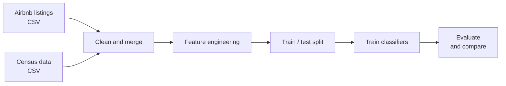

<div align="center">

# 🏙️ airbnb-price-category-predictor

**Binary classification of ~28K NYC Airbnb listings into high-priced (top quartile) or low-priced, to help hosts judge how a listing's attributes relate to its price tier.**

<p align="center">
  &nbsp;&nbsp;
  &nbsp;&nbsp;
  &nbsp;&nbsp;
  
</p>

</div>

---

## 📌 TL;DR

| | |
|---|---|
| **What** | A classifier that predicts whether an NYC Airbnb listing is in the top price quartile |
| **Target** | `high_price = 1` if the nightly price is in the top 25% of listings, otherwise `0` |
| **Data** | ~28K NYC listings (`airbnbListingsData.csv.gz`) joined with census data (`censusData.csv`) |
| **Model(s)** | TODO: for example, logistic regression, random forest, gradient boosting |
| **Best result** | TODO: for example, ROC-AUC 0.xx, F1 0.xx (see [Results](#-results-and-key-findings)) |

## 🔍 Project Overview

TODO: 3–4 sentences. Explain the problem (hosts struggle to know whether their listing sits in a high or low price tier), what you built, and what you learned. Mention that the model describes how attributes relate to price tier and is not a pricing tool.

## 🎯 Objectives and Goals

1. Clean and prepare ~28K NYC Airbnb listings for modeling.
2. Combine listing attributes with neighborhood-level census data.
3. Train classifiers to separate high-priced from low-priced listings.
4. Evaluate each model with appropriate metrics for an imbalanced (75/25) target.
5. Identify which attributes matter most to the price tier.

## 🧪 Methodology



1. **Cleaning:** TODO: for example, how you handled missing values, price formatting, and outliers.
2. **Merging:** TODO: the key you used to join the census data (ZIP code, neighborhood, or tract).
3. **Target:** the top quartile of price is labeled high-priced. TODO: state the price cutoff in dollars.
4. **Features:** TODO: list the main feature groups, such as room type, neighborhood, number of reviews, availability, and census variables.
5. **Models:** TODO: list the models and any tuning (for example cross-validation or grid search).
6. **Evaluation:** TODO: the metrics you report (accuracy, precision, recall, F1, ROC-AUC, confusion matrix) and the test split ratio.

## 📊 Results and Key Findings

TODO: replace the table with your real numbers.

| Model | Accuracy | Precision | Recall | F1 | ROC-AUC |
|---|---|---|---|---|---|
| TODO | TODO | TODO | TODO | TODO | TODO |

**Key findings**

- TODO: the strongest predictors of a high price tier.
- TODO: where the model struggles (for example, borderline listings near the cutoff).
- TODO: whether the census features added value over listing features alone.

## 🗃️ Dataset

| File | Description |
|---|---|
| `data/airbnbListingsData.csv.gz` | ~28K NYC Airbnb listings. TODO: source and collection date |
| `data/censusData.csv` | Census attributes by area. TODO: source and year |

**Column dictionary**

| Column | Description |
|---|---|
| TODO | TODO |
| TODO | TODO |

The listings file is compressed, and pandas reads it directly:

```python
import pandas as pd
listings = pd.read_csv("data/airbnbListingsData.csv.gz")
census = pd.read_csv("data/censusData.csv")
```

## 🚀 Installation and Setup

### 1. Set up the project locally

**You need:** Python 3.TODO and `pip`.

```bash
# 1. Clone
git clone https://github.com/NehaM2025/airbnb-price-category-predictor.git
cd airbnb-price-category-predictor

# 2. Create a virtual environment
python -m venv venv
source venv/bin/activate        # Windows: venv\Scripts\activate

# 3. Install dependencies
pip install -r requirements.txt
```

### 2. Train the model

```bash
# TODO: pick one that matches your project
jupyter notebook notebooks/TODO-training.ipynb
# or
python src/train.py
```

TODO: say where the trained model is saved, if it is.

### 3. Evaluate model performance

```bash
# TODO: pick one that matches your project
jupyter notebook notebooks/TODO-evaluation.ipynb
# or
python src/evaluate.py
```

The evaluation prints the metrics table and draws the confusion matrix and ROC curve.

### Run in Colab

[](https://colab.research.google.com/github/NehaM2025/airbnb-price-category-predictor/blob/main/notebooks/TODO.ipynb)

## 📚 Documentation

| Document | What it covers |
|---|---|
| This README | User guide: setup, training, evaluation, and results |
| [API Reference](docs/API_Reference.md) | Functions and modules: inputs, outputs, and examples |
| [Notebooks](notebooks/) | Annotated walkthroughs of cleaning, training, and evaluation |
| [Data dictionary](#-dataset) | Column definitions for both datasets |

## 🗂️ Repository Structure

```
airbnb-price-category-predictor/
├── README.md
├── requirements.txt
├── data/
│   ├── airbnbListingsData.csv.gz
│   └── censusData.csv
├── notebooks/                    # renamed from "Predictor Model"
│   └── TODO.ipynb
├── src/                          # optional: reusable functions
│   └── TODO.py
└── docs/
    └── API_Reference.md
```

## ⚠️ Limitations

- The target is relative (top quartile), so the dollar cutoff depends on this dataset's date.
- TODO: other limits, such as missing features, a single city, and a single time period.
- The model shows association, not causation: it does not say that changing an attribute will change the price.

## 🔭 Potential Next Steps

- TODO: for example, try regression on the exact price, add text features from listing descriptions, or test on a different city.

## 🙋 Individual Contributions

TODO: if this is a team project, list who did what. If it is solo work, replace this with a short "About the author" line.

## 📄 License

TODO: for example, MIT. Add a `LICENSE` file to match.

---
