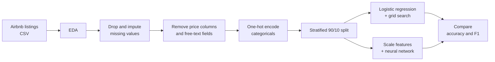

<div align="center">

# 🏙️ airbnb-price-category-predictor

**Binary classification of ~28K NYC Airbnb listings into high-priced (top quartile) or low-priced, to help hosts judge how a listing's attributes relate to its price tier.**

<p align="center">
  &nbsp;&nbsp;
  &nbsp;&nbsp;
  &nbsp;&nbsp;
  &nbsp;&nbsp;
  
</p>

</div>

---

## 📌 TL;DR

| | |
|---|---|
| **What** | A classifier that predicts whether an NYC Airbnb listing falls in the top price quartile |
| **Target** | `price_category`: `high` (priced $180 or more) or `low` (priced $179 or less) |
| **Data** | 28,022 NYC listings in `data/airbnbListingsData.csv.gz` |
| **Models** | Logistic regression (tuned with grid search) and a two-hidden-layer neural network |
| **Notebook** | [`notebooks/airbnb_price_classifier.ipynb`](https://github.com/NehaM2025/airbnb-price-category-predictor/blob/main/airbnb_price_classifier.ipynb) runs the full pipeline |

## 🔍 Project Overview

Hosts often struggle to tell whether a listing sits in the high or low price tier. This project trains two classifiers on listing attributes such as capacity, bedrooms, bathrooms, room type, and host details, then compares an interpretable model (logistic regression) with a more flexible one (a neural network). The goal is to describe how a listing's attributes relate to its price tier. It is not a pricing tool, and the [ethical considerations](#️-ethical-considerations) below explain why predictions should not be the only input to a pricing decision.

## 🎯 Objectives and Goals

1. Explore and clean ~28K NYC Airbnb listings, including missing values and class imbalance.
2. Prepare features for modeling without leaking the price into the inputs.
3. Train and tune a logistic regression baseline.
4. Train a neural network and compare it with the baseline.
5. Identify which attributes matter most and discuss the ethical risks of the model.

## 🧪 Methodology



1. **EDA:** class distribution, price boxplot, and listing counts by availability, room type, bedrooms, bathrooms, and superhost status. Correlations with the label guide feature selection.
2. **Missing values:** `host_response_rate`, `host_acceptance_rate`, `host_about`, and `neighborhood_overview` are each missing for roughly 9,000+ listings and only weakly correlated with the label, so they are dropped. `bedrooms`, `beds`, and `bathrooms` are filled with the median, and `host_location` with `"Unknown"`.
3. **Leakage prevention:** `price` and the label columns are removed from the features, since the label is built from price. Free-text and unique-per-row fields (`host_name`, `amenities`, `name`, `description`) are also removed.
4. **Encoding:** the remaining categorical columns (`host_location`, `neighbourhood_group_cleansed`, `room_type`) are one-hot encoded with `drop_first=True`, giving 1,409 features.
5. **Split:** 90% train / 10% test, stratified on the label, `random_state=1234`.
6. **Class imbalance:** low-priced listings outnumber high-priced ones about 3 to 1, so logistic regression uses `class_weight="balanced"`.
7. **Logistic regression:** `GridSearchCV` with 5-fold cross-validation over `C` from 10⁻⁵ to 10⁴.
8. **Neural network:** standardized inputs → Dense(64, ReLU) → Dense(32, ReLU) → Dense(1, sigmoid). Trained with SGD (learning rate 0.001) for 30 epochs, with a 20% validation split.

## 📊 Results and Key Findings

The last section of the notebook prints a comparison table for both models, plus per-class reports and confusion matrices. Because 74.2% of listings are low-priced, **always predicting "low" already scores 74.2% accuracy**, so judge each model against that baseline and by its F1 on the high-priced class, not by accuracy alone.

**Key findings**

- **Capacity and size matter most.** `accommodates`, `bedrooms`, `beds`, and `bathrooms` have the strongest correlations with the price category, so larger properties are more likely to be high-priced.
- **No single feature is enough.** Most other numeric features are only weakly correlated with the label.
- **Logistic regression is easier to explain.** Its coefficients show which attributes push a listing toward a price tier, which is useful if hosts need to understand a prediction.
- **The neural network is more flexible** but harder to interpret, and it can overfit if trained for too many epochs (see the training curves in the notebook).
- **Scaling matters for logistic regression.** Unscaled one-hot and numeric features converge poorly, which is why standardizing the inputs is listed in the next steps.

## 🗃️ Dataset

| File | Description |
|---|---|
| `data/airbnbListingsData.csv.gz` | 28,022 NYC Airbnb listings × 51 columns (about 14.5 MB compressed) |

**Target:** `price_category` is `high` for listings priced at $180 or more (7,237 listings, 25.8%) and `low` for listings priced at $179 or less (20,785 listings, 74.2%).

**Columns** (51 in total; the main groups are below)

| Column group | Description |
|---|---|
| `price_category` | Target label: `high` or `low` |
| `price` | Nightly price in dollars (builds the label, excluded from the features) |
| `accommodates`, `bedrooms`, `beds`, `bathrooms` | Listing size and capacity |
| `room_type` | Entire home/apt, private room, hotel room, or shared room |
| `neighbourhood_group_cleansed` | Borough: Manhattan, Brooklyn, Queens, Bronx, or Staten Island |
| `host_*` | Host details: location, superhost status, verification, listing counts, response and acceptance rates |
| `minimum_nights`, `maximum_nights` and the `*_nights_*` variants | Booking length rules |
| `availability_30/60/90/365`, `has_availability` | Availability windows |
| `number_of_reviews*`, `reviews_per_month`, `review_scores_*` | Review volume and ratings |
| `instant_bookable`, `n_host_verifications`, `calculated_host_listings_count*` | Booking and host-portfolio features |
| `name`, `description`, `neighborhood_overview`, `host_about`, `amenities`, `host_name` | Free text and identifiers (not used as features) |

**Missing values:** `host_response_rate` (11,843), `host_acceptance_rate` (11,113), `host_about` (10,945), and `neighborhood_overview` (9,816) are dropped. `bedrooms` (2,918) and `beds` (1,354) are filled with the median, and `host_location` (60) with `"Unknown"`.

pandas reads the compressed file directly:

```python
import pandas as pd
df = pd.read_csv("data/airbnbListingsData.csv.gz")
```

## 🚀 Installation and Setup

### 1. Set up the project locally

**You need:** Python 3.9 or newer (a version supported by TensorFlow) and `pip`.

```bash
# 1. Clone
git clone https://github.com/NehaM2025/airbnb-price-category-predictor.git
cd airbnb-price-category-predictor

# 2. Create a virtual environment
python -m venv venv
source venv/bin/activate        # Windows: venv\Scripts\activate

# 3. Install dependencies
pip install -r requirements.txt
```

### 2. Train the models

```bash
jupyter notebook notebooks/airbnb_price_classifier.ipynb
```

Run all cells from top to bottom. The notebook trains the logistic regression (the grid search can take several minutes) and then the neural network (30 epochs).

### 3. Evaluate model performance

The notebook evaluates both models on the held-out 10% test set. After each model it prints accuracy, F1, a per-class report, and a confusion matrix. The final comparison table sets both models next to the always-predict-low baseline. The training and validation loss and accuracy curves appear after the neural network cell.

### Run in Colab

[

The notebook loads the data from GitHub automatically when it is not found locally.

## ⚖️ Ethical Considerations

- **Limited scope.** The data covers NYC listings from one platform at one point in time, so results do not generalize to other cities or to today's market.
- **Proxy features.** Neighborhood and location features can act as proxies for income, socioeconomic status, or race, and the model can reinforce existing pricing patterns.
- **Harm to hosts.** A wrong prediction can lead a host to under- or overprice a listing, which costs bookings or revenue. Less experienced hosts may rely on the model more heavily.
- **Recommendation.** Use the predictions as one input among several, not as the final pricing decision.

## 🗂️ Repository Structure

```
airbnb-price-category-predictor/
├── README.md
├── requirements.txt
├── data/
│   └── airbnbListingsData.csv.gz
└── notebooks/
    └── airbnb_price_classifier.ipynb
```

## 🔭 Potential Next Steps

- **Standardize inputs for logistic regression** so both models are compared on equal terms and the coefficients are comparable.
- **Tune the neural network:** grid-search depth, neurons per layer, learning rate, and optimizer instead of a single configuration.
- **Early stopping:** stop training once validation loss stops improving, to reduce overfitting.
- **Feature engineering:** prune weak or noisy one-hot features (for example `host_location`, which has 1,364 distinct values), scale skewed numeric features, and analyze feature importance.

---
